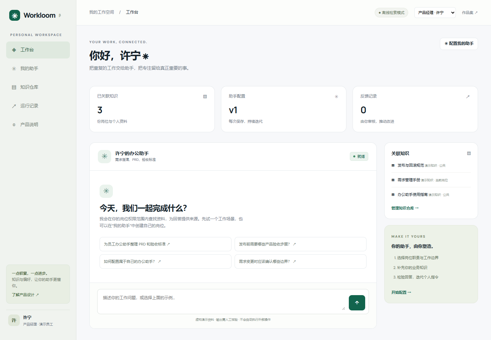
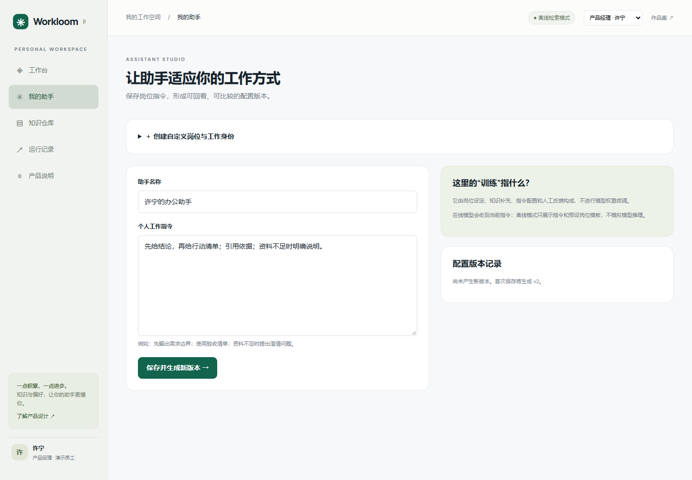
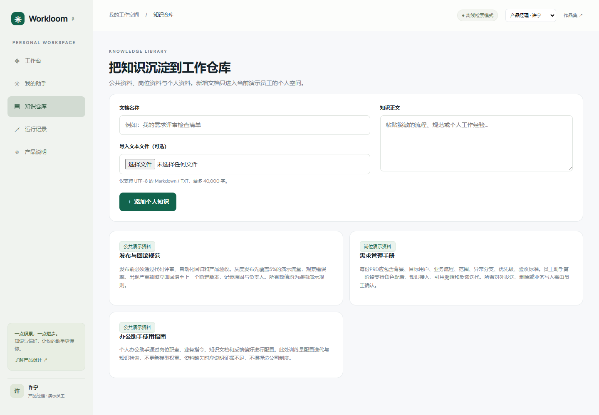
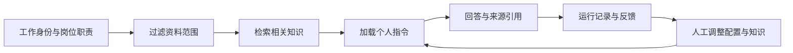

<div align="center">

# Workloom

### 面向不同岗位的个人办公助手工作仓库

将岗位职责、业务知识和工作习惯组织到一个可持续迭代的员工工作空间。

[功能特性](#功能特性) · [界面预览](#界面预览) · [快速开始](#快速开始) · [项目迭代](#项目迭代) · [开发文档](docs/DEVELOPMENT.md)

**Python · 原生 JavaScript · SQLite · MIT License**

</div>

## 项目介绍

通用对话工具往往缺少岗位职责、业务背景和个人工作习惯。Workloom 将这些信息与知识检索、指令配置、来源引用和反馈记录结合起来，让员工建立自己的办公助手。

项目提供开发、测试、产品、数据、运营、人事、财务等岗位示例，也支持创建任意岗位、填写职责和工作步骤。员工可以补充个人知识，保存助手配置，并在具体任务中核对依据、记录问题、继续改进。

## 界面预览

### 个人工作台

查看当前身份、关联知识、助手配置和最近任务，在一个页面内开始工作。



### 助手配置

自定义岗位和职责，调整个人指令，保留配置版本。



### 个人知识仓库

接入文本资料，查看公共、岗位和个人文档，围绕自己的业务知识进行检索。



## 功能特性

| 功能 | 用途 |
| --- | --- |
| 自定义工作身份 | 按岗位、员工称呼、职责和步骤创建自己的工作空间 |
| 个人助手配置 | 设置名称与业务指令，保存并回看配置版本 |
| 个人知识接入 | 添加文本资料、导入 Markdown / TXT、管理个人文档 |
| 带来源的知识回答 | 在资料范围内检索片段，展开原文与来源进行核对 |
| 反馈与迭代 | 记录有帮助或待改进的回答，支持人工调整配置 |
| 运行记录 | 回看任务与回答，导出 JSON 进行复盘 |
| 模型服务接入 | 通过服务端连接兼容 Chat Completions 的模型服务 |

## 快速开始

需要 **Python 3.11 或以上版本**。

```bash
git clone https://github.com/Sy-SUNY/workloom.git
cd workloom
python server.py
```

打开 **http://127.0.0.1:8080** 即可使用。Windows 也可双击 `start.cmd` 启动。

### 配置模型服务

默认可直接体验知识检索。连接模型服务后，助手可基于检索资料生成回答。以下为 PowerShell 配置示例：

```powershell
$env:LLM_BASE_URL = 'http://127.0.0.1:11434/v1'
$env:LLM_MODEL = 'your-local-model'
# 服务需要密钥时，通过 LLM_API_KEY 环境变量配置。
python server.py
```

运行模式会在界面中标识：未连接模型时展示知识摘录，连接模型后使用模型生成；静态托管采用浏览器本地演示。

## 使用流程

1. 选择一个岗位示例，或在「我的助手」里创建自己的岗位与工作身份。
2. 在「知识仓库」中添加脱敏业务资料。
3. 调整助手名称、工作指令与输出偏好，保存配置版本。
4. 输入具体任务，查看回答、原文引用与运行链路。
5. 记录反馈，人工调整指令或补充资料，再次验证。

## 项目迭代

| 阶段 | 场景与实现 |
| --- | --- |
| 基础工作空间 | 从常见岗位出发，打通知识检索、引用、个人配置、反馈与任务记录 |
| 个性化工作身份 | 从固定岗位扩展到自定义职责和工作步骤，加入配置版本、个人资料范围与身份持久化 |
| 可演示与可复盘 | 提供本地服务和静态演示入口，支持运行链路、历史查询与记录导出 |

## 工作链路



## 项目结构

```text
workloom/
├── server.py           # 本地服务、知识检索、模型接入与数据持久化
├── build.py            # 静态演示导出
├── web/                # 工作台、配置、知识与运行记录界面
├── tests/              # 接口与资料范围等行为验证
├── docs/               # 项目截图与开发说明
└── .github/workflows/  # 自动检查与静态页面发布配置
```

## 开发与验证

```bash
python -m unittest discover -s tests -v
python build.py
```

更多接口、运行模式、检索方法和部署说明见 [开发文档](docs/DEVELOPMENT.md)。

## 项目背景

本项目由 [孙悦 / Sy-SUNY](https://github.com/Sy-SUNY) 基于企业员工助手的实习场景独立重建。原实习职责为产品需求、整体技术链路确定与迭代；仓库代码为后续实现，采用虚构业务资料。

当前版本面向本地运行与项目展示。演示身份通过请求头切换；多人生产部署应接入真实登录与服务端授权。“训练助手”在本项目中指指令、知识和反馈迭代。

设计调研参考 Onyx FOSS、AnythingLLM、Dify 与 LangGraph，业务代码独立实现。来源见 [RESEARCH.md](RESEARCH.md)。

## License

[MIT](LICENSE)
