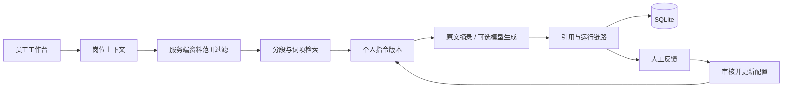

# Workloom · 个人办公 Agent 工作仓库

孙悦（[Sy-SUNY](https://github.com/Sy-SUNY)）的员工办公助手项目与实习场景脱敏重建。

开发、测试、数据、运营、人事、财务等岗位各有不同职责，也可以自定义工作身份。Workloom 将岗位模板、个人指令、知识资料、来源引用和人工反馈组织成每位员工自己的工作空间。

> 原实习职责：产品经理，负责整体技术链路确定及迭代；方向为大模型与智能体。本仓库是后续独立重建，不含原公司的源码、文档与业务数据。所有演示员工和业务制度均为虚构。

## 立即运行

需要 Python 3.11+，**无第三方运行依赖**：

```sh
python server.py
```

打开 http://127.0.0.1:8080 即可体验工作仓库。

Windows 可双击 `start.cmd`。服务仅监听本机回环地址，关闭终端即可停止。

## 两种部署形态，三种明确标识的模式

| 形态 | 模式 | 能力与限制 |
| --- | --- | --- |
| Python 后端 | 离线检索（默认） | 服务端资料范围过滤、中文双字词/英文词项检索、原文摘录、岗位模板、SQLite 持久化；不调用大模型 |
| Python 后端 | 模型生成（可选） | 在上述检索基础上调用兼容 Chat Completions 的模型 API；需要自行提供模型配置 |
| 静态网站 | 浏览器演示 | localStorage 保存配置和示例资料，原文检索摘录；不调用大模型、无服务端权限保护 |

本项目的“训练自己的助手”指岗位与指令配置、知识补充和人工反馈迭代，**不进行模型权重微调**。反馈不会未经审核自动写入知识或修改指令。

## 模型服务配置

使用任意支持 `POST /v1/chat/completions` 的兼容服务或本地模型。以 PowerShell 为例（替换为自己的配置）：

```powershell
$env:LLM_BASE_URL = 'http://127.0.0.1:11434/v1'
$env:LLM_MODEL = 'your-local-model'
# 如服务需要密钥，设置 LLM_API_KEY；不要写入仓库或前端。
python server.py
```

`LLM_BASE_URL` 包含 `/v1` 等基础路径，代码会追加 `/chat/completions`。仅同时配置 URL 和 MODEL 时启用模型模式。模型错误返回明确失败，不暗中回退为模拟生成。仓库测试只验证模拟模型服务的接口契约，未验证任何付费真实模型。

## 五分钟面试演示

1. 进入工作台，选择产品经理；解释岗位职责与知识范围。
2. 添加个人文档，内容写入虚构业务规则；在“我的助手”保存一版新指令。
3. 围绕文档关键词提问，展开原文引用与运行链路；指出当前模式是否调用模型。
4. 提交改进反馈，在配置中人工修改指令，生成新版本。
5. 切换测试工程师，确认产品经理的个人文档与历史不可见；说明生产环境还需要真实登录。

产品思考详见 [项目复盘](web/case-study.html)，同类产品与作品集参考详见 [调研页面](web/research.html)。

## 已实现

- 办公助手工作台、项目说明与调研记录。
- 开发、测试、产品、数据、运营、人事、财务等岗位模板，以及自定义岗位、职责、工作步骤和独立知识空间。
- 个人指令保存及版本历史。
- Markdown / TXT 内容接入、个人文档删除。
- 服务端先过滤资料范围，再分段检索；返回引用和原文片段。
- 运行链路与记录、反馈保存、历史 JSON 导出。
- 可选兼容模型 API，密钥仅留在服务端环境。
- 无密钥可运行的静态交互演示和 GitHub Pages 工作流。

## 架构



检索对中文使用双字词，对英文使用词项，按重合比例排序，分段长度480字符、步长380、取前4片段。这是可解释的知识检索基线，未使用向量数据库，不宣称已达到语义 RAG 的召回能力。生成内容仍需要人工核验；模型生成的引用编号未做自动事实验证。

## 测试与静态导出

```sh
python -m unittest discover -s tests -v
python build.py
```

测试覆盖：岗位资料范围、个人文档越权读取/删除、历史归属、配置版本、反馈归属、输入校验、跨站写入与模型接口契约。构建产物在 `dist/`，可以部署到 GitHub Pages；静态托管自动启用明确标识的浏览器演示。

GitHub Pages：仓库 Settings → Pages → Source 选择 GitHub Actions，然后在 Actions 中手动运行 **Deploy portfolio to GitHub Pages**。工作流暂用手动触发，避免未经设置就产生失败部署。

## API

接口使用 JSON，请求头 `X-Demo-Role` 使用 `/api/state` 返回的岗位 ID，包括内置模板与新建的自定义身份。

| 路径 | 方法 | 输入 |
| --- | --- | --- |
| `/api/health` | GET | 无 |
| `/api/state` | GET | 无；返回当前岗位资料、配置、历史 |
| `/api/roles` | POST | `name`, `employee`, `focus`, `steps`（每行一步） |
| `/api/chat` | POST | `question` |
| `/api/profile` | POST | `name`, `instructions` |
| `/api/documents` | POST | `title`, `content`；新增仅为个人资料 |
| `/api/documents/delete` | POST | `id`；仅能删除本人文档 |
| `/api/feedback` | POST | `run_id`, `rating`（1 / -1）, `correction` |

SQLite 默认存放于忽略提交的 `data/workloom.db`，可通过 `WORKLOOM_DB` 设置路径。演示角色由请求头选择，不提供真实员工身份认证。不得将请求头当作企业权限凭据。公开多用户后端部署前需增加登录、服务端身份绑定、租户授权、限流、迁移及数据生命周期管理。

## 调研与原创实现

本次先研究 [Onyx FOSS](https://github.com/onyx-dot-app/onyx-foss)、[AnythingLLM](https://github.com/Mintplex-Labs/anything-llm)、[Dify](https://github.com/langgenius/dify)、[LangGraph](https://github.com/langchain-ai/langgraph)，再针对岗位与个人迭代闭环实现。它们是设计参考，**本仓库不是这些项目的 Fork，也没有复制上游源码**。取舍、能力对应与许可说明见 [RESEARCH.md](RESEARCH.md)。

作品集参考 [Brittany Chiang](https://brittanychiang.com/) 的信息层次与 [Lee Robinson](https://leerob.com/) 的简洁个人叙述，未复制页面源码。原实习职责与本次工程产出始终分开表述，不虚构业务指标或落地成果。

第二个项目暂未确定。
